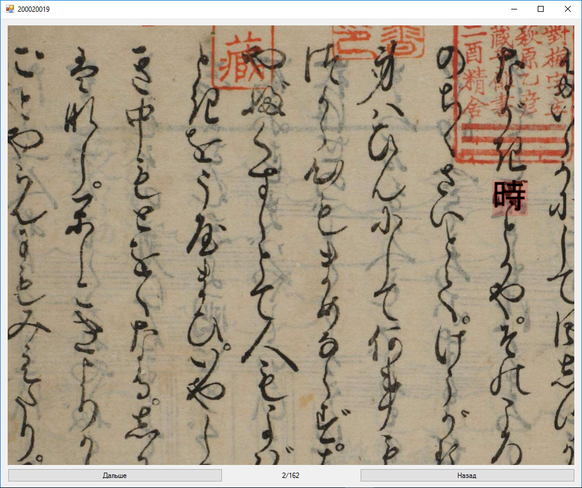

# JP Book Viewer

Reader for <a href="http://codh.rois.ac.jp/char-shape/book/">codh.rois char-shape books</a>.

Download a book, extract the `images` folder and `*_coordinate.csv`, then start the program, select that folder and open the viewer.



## Features

- Smooth zoom with the mouse wheel (zooms at the cursor), drag to pan, double-click to fit the page.
- Page navigation with the buttons, `←` / `→`, `PageUp` / `PageDown`, `Home` / `End`.
- Two kanji display modes: glyph over the character area, or a hint box in the corner.
- Remembers the last book, page and display mode.
- Optional static web export (`Book.ProcessToWeb`).

## Requirements

- Windows 10 version 2004 (build 19041) or newer.
- [.NET 10 Desktop Runtime](https://dotnet.microsoft.com/download/dotnet/10.0) for framework-dependent builds.

## Build

```powershell
dotnet build JpBookViewer.sln
dotnet run --project JpBookViewer
```

## Publish

Self-contained single-file executable:

```powershell
dotnet publish JpBookViewer -c Release -r win-x64 --self-contained true -p:PublishSingleFile=true -p:IncludeNativeLibrariesForSelfExtract=true
```

The executable is produced as `CodhRoisReader.exe`.

## Data layout

```text
<book-id>/
  <book-id>_coordinate.csv
  images/
    <book-id>_00001_1.jpg
    ...
```

The CSV columns are `Unicode,Image,X,Y,Block ID,Char ID,Width,Height`.

## Technology

- .NET 10 / WinForms
- [SkiaSharp](https://github.com/mono/SkiaSharp) for rendering and image decoding
- JSON configuration in `%LOCALAPPDATA%\CodhRoisReader\config.json`
  (the legacy `config.xml` is imported automatically)
